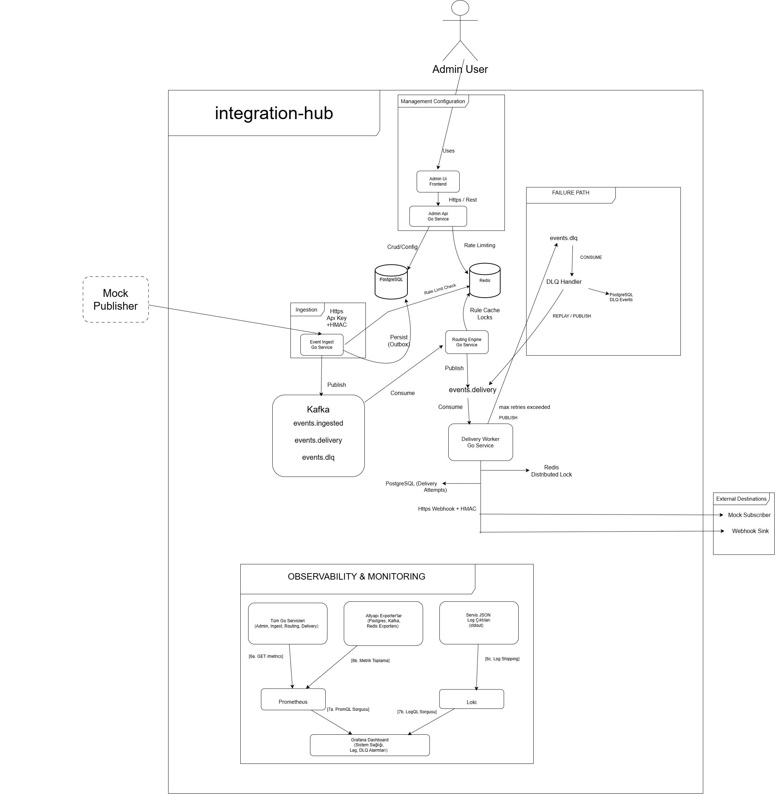
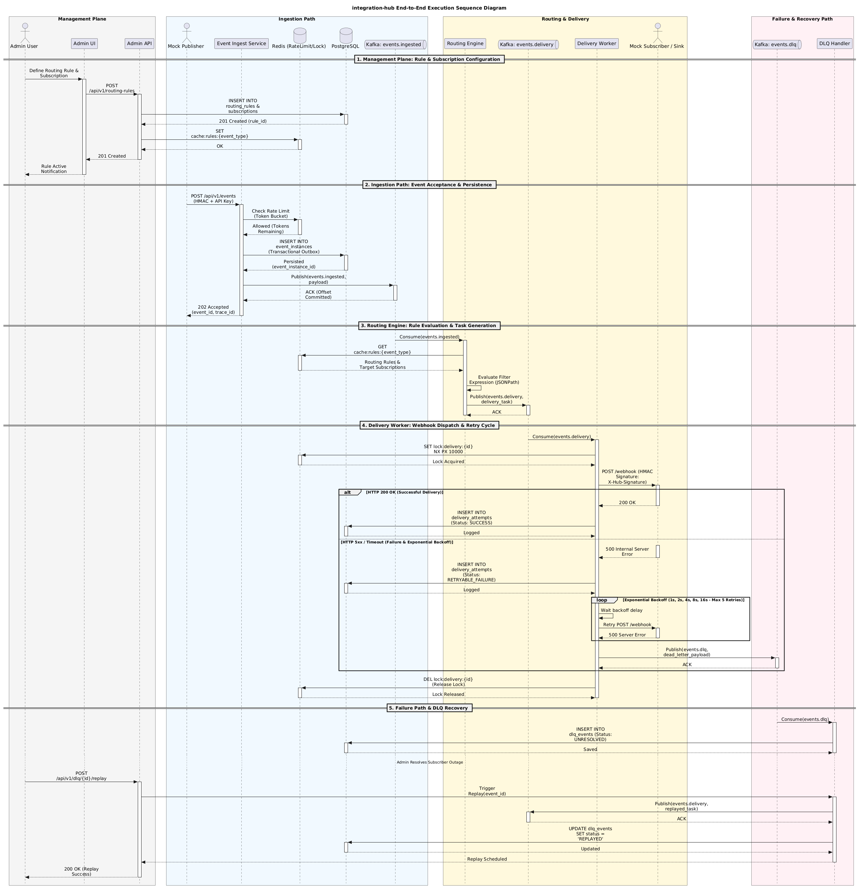
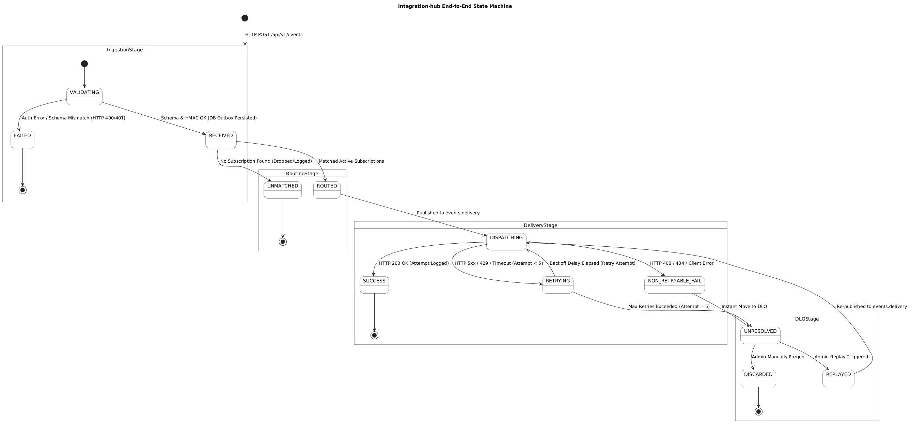
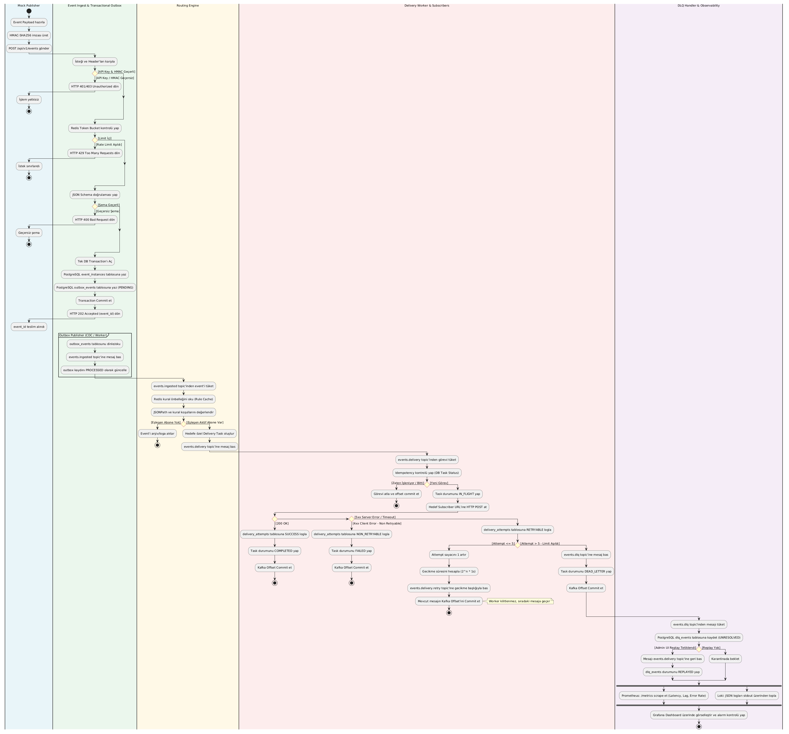
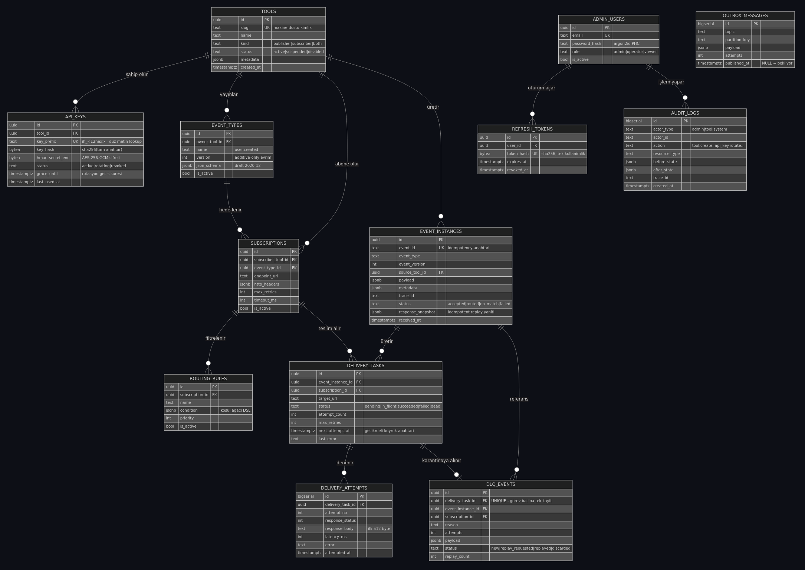

# MindMons Integration & Event Hub

> Ekosistemdeki bağımsız yazılım ürünlerinin (tool'ların) birbirine **event
> tabanlı**, gevşek bağlı ve güvenilir biçimde konuşmasını sağlayan merkezi
> entegrasyon platformu.

Hiçbir tool diğerine hardcoded bağlı değildir. Yeni bir tool eklemek için
**kod değiştirmek gerekmez** — admin panelinden tanımlanır.

```
Publisher Tool ──HTTP+HMAC──▶ Integration Hub ──Webhook+HMAC──▶ Subscriber Tool
                                     │
                        kabul et · kaybetme · yönlendir
                        teslim et · yeniden dene · karantinaya al
```

---

## Hızlı başlangıç

**Ön koşul:** Docker + Docker Compose (~6 GB boş disk, ~4 GB RAM)

```bash
./scripts/gen-secrets.sh          # .env'i güçlü rastgele secret'larla üretir
docker compose up -d --build      # ~20 servis ayağa kalkar
docker compose ps                 # hepsi healthy olana kadar bekleyin (~90 sn)
```

> **Windows notu.** `gen-secrets.sh` bash gerektirir (Git Bash / WSL).
> Elle oluşturuyorsanız:
> - `SECRET_ENCRYPTION_KEY` **tam 64 hex karakter** olmalı (`openssl rand -hex 32`).
> - Şifrelerde `@ / # : ?` gibi karakter kullanmayın — Postgres bağlantı dizesi
>   bir URL'dir ve bu karakterler onu bozar. Yalnızca `[A-Za-z0-9]` kullanın.
> - `.env` dosyasını **LF** satır sonuyla kaydedin. CRLF ile kaydedilirse
>   container içindeki bash betikleri değerlerin sonuna `\r` ekler ve
>   kimlik doğrulama sessizce başarısız olur.

Giriş bilgileri `.env` içindedir:

```bash
grep -E '^(ADMIN_EMAIL|ADMIN_PASSWORD|GRAFANA_ADMIN_PASSWORD)=' .env
```

### Servis adresleri

| Servis | Adres | Açıklama |
| :--- | :--- | :--- |
| **Admin UI** | http://localhost:3000 | Yönetim paneli — buradan başlayın |
| **Mock Publisher** | http://localhost:8090 | Event fırlatma arayüzü |
| **Mock Subscriber** | http://localhost:8091 | Webhook alıcı + arıza simülasyonu |
| **Webhook Sink** | http://localhost:8092 | Platform ne gönderdi? (debug) |
| **Grafana** | http://localhost:3001 | 4 dashboard, canlı metrik + log |
| **Swagger UI** | http://localhost:8080/docs | API kontratı |
| Prometheus | http://localhost:9090 | Metrik sorgulama, alert durumu |
| Kafka UI | http://localhost:8085 | Topic, partition, consumer lag |
| pgAdmin | http://localhost:5050 | Veritabanı |
| Admin API | http://localhost:8080 | Kontrol düzlemi REST API |
| Event Ingest | http://localhost:8081 | Event kabul ucu |

### İlk 60 saniye

1. http://localhost:8090 → **"Event gönder"**
2. http://localhost:3000/events → event akışta görünür
3. http://localhost:8092 → webhook'un tam gövdesi ve imza durumu
4. http://localhost:3000 → dashboard'da canlı grafikler

Mock tool'lar platforma **kendilerini otomatik kaydeder**; elle kurulum adımı yoktur.

---

## Mimari



### Servisler

| Servis | Sorumluluk (tek cümle) | Port |
| :--- | :--- | :--- |
| **admin-api** | Ekosistem konfigürasyonunu yönetir ve operasyonel veriyi sunar (kontrol düzlemi) | 8080 |
| **event-ingest** | Event'leri doğrulayıp kalıcı hâle getirir ve Kafka'ya güvenle aktarır | 8081 |
| **routing-engine** | Bir event'in hangi subscriber'lara gideceğine karar verir | 8082 |
| **delivery-worker** | Webhook'u gönderir, hataları retry/DLQ politikasıyla yönetir | 8083 |
| **dlq-handler** | Teslim edilemeyen mesajları saklar, replay ve retention yürütür | 8084 |

**Neden bu bölünme?** Her servisin **tek bir değişme sebebi** var ve her biri
farklı bir kaynak profiline sahip:

- `event-ingest` en yüksek istek hacmini görür → bağımsız ölçeklenmeli.
- `delivery-worker` yavaş dış sistemleri bekler → I/O-bound, izole edilmeli.
- `admin-api` düşük trafiklidir ama **her zaman erişilebilir** olmalı — event
  akışındaki bir tıkanıklık yönetim panelini düşürmemeli.

Karar verme (`routing-engine`) ile teslimat (`delivery-worker`) bilinçli olarak
ayrıldı: yavaş bir subscriber, karar verme hızını etkilememeli.

Alternatif bölünmeler ve neden reddedildikleri: [`docs/02-service-architecture.md`](docs/02-service-architecture.md)

### Event akışı



### Teslimat durum makinesi



```
pending ──▶ in_flight ──2xx──▶ succeeded
                │
                ├──5xx/timeout, bütçe var──▶ pending (backoff: 1s,2s,4s,8s,16s)
                └──bütçe bitti / 4xx──────▶ dead ──▶ DLQ ──replay──▶ pending
```

### Aktivite akışı



### Veri modeli



---

## Uygulanan mimari desenler

| Desen | Çözdüğü problem |
| :--- | :--- |
| **Transactional Outbox** | "DB'ye yazdım ama Kafka'ya basamadım" → sıfır veri kaybı |
| **Idempotent Consumer** | At-least-once teslimatın mükerrer yan etkisi |
| **Exponential Backoff + Jitter** | Geçici hata; eşzamanlı retry'ların hedefi tekrar çökertmesi |
| **Dead Letter Queue** | Kalıcı hatanın sonsuz retry ile kaynak yakması |
| **Circuit Breaker** | Çökmüş hedefe boşuna istek atıp worker havuzunu tıkamak |
| **Bulkhead** | Yavaş komşunun tüm teslimat kapasitesini işgal etmesi |
| **Distributed Lock** | Aynı görevin iki worker tarafından işlenmesi |
| **Delayed Queue (DB)** | Kafka'da yerleşik gecikmeli mesaj olmaması |
| **Cache-Aside + Generation** | Kural okumanın her event'te DB'ye gitmesi |

Her birinin gerekçesi: [`docs/03-tech-stack.md`](docs/03-tech-stack.md) §12

---

## Güvenlik

| Katman | Mekanizma |
| :--- | :--- |
| Tool kimliği | API key (`ih_<prefix>_<secret>`) — DB'de yalnızca **SHA-256 hash** |
| İstek bütünlüğü | HMAC-SHA256, imza gövde + zaman damgasını kapsar |
| Replay koruması | Zaman damgası imzaya dahil, ±5 dk pencere |
| Timing attack | `crypto/subtle.ConstantTimeCompare` |
| Admin kimliği | JWT (15 dk access) + **tek kullanımlık** refresh token |
| Şifre | argon2id (64 MiB, t=3, p=2 — OWASP) |
| Secret saklama | HMAC secret'ları AES-256-GCM ile şifreli |
| Rate limiting | Redis atomik token bucket: IP + tool + admin kullanıcı |
| DB izolasyonu | **Servis başına Postgres rolü**, tablo bazlı GRANT |
| Container | Tümü **non-root** (distroless / nginx-unprivileged) |
| Denetim | Her CUD işlemi `audit_logs`'ta önce/sonra durumuyla |

Kapsanan ve **kapsanmayan** tehditler: [`docs/08-threat-model.md`](docs/08-threat-model.md)

---

## Demo senaryosu (15 dakika)

### 1 — Ekosistemi tanıyın (2 dk)

http://localhost:3000 → giriş yapın.

- **Tool'lar**: 3 tool otomatik kaydolmuş (1 publisher, 2 subscriber)
- **Event Tipleri**: 3 tip, JSON Schema kontratlarıyla
- **Abonelikler**: 6 abonelik
- **Yönlendirme Kuralları**: 6 koşulsuz kural

### 2 — Mutlu yol (2 dk)

http://localhost:8090 → **"Event gönder"** (veya "10 event burst")

Sırayla izleyin:
- Admin UI → **Event Akışı**: durum `routed`
- Admin UI → **Teslimatlar**: her event 2 subscriber'a, `200`
- http://localhost:8092 → webhook'un tam gövdesi, `imza: valid`
- Admin UI → **Panel**: canlı akış ve grafikler

### 3 — Idempotency (1 dk)

http://localhost:8090 → **"Aynı id'yi 2 kez gönder"**

İkinci gönderim `(mükerrer)` olarak işaretlenir. Doğrulayın:

```bash
docker compose exec postgres psql -U hub_admin -d integration_hub -c \
  "SELECT event_id, count(*) FROM hub.event_instances GROUP BY 1 HAVING count(*) > 1;"
# 0 satır — mükerrer kayıt yok
```

### 4 — Yönlendirme filtresi (2 dk)

Admin UI → **Yönlendirme Kuralları** → bir kuralı düzenleyin:

```json
{ "op": "and", "rules": [{ "path": "payload.status", "op": "eq", "value": "premium" }] }
```

**"Kuralı test et"** ile canlıya almadan deneyin. Kaydedin, sonra event
fırlatın: artık o subscriber'a gitmiyor (`no_match`).

### 5 — Arıza, retry ve DLQ (5 dk)

http://localhost:8091 → **"Hepsini fail et"**

Event fırlatın ve logları izleyin:

```bash
docker compose logs -f delivery-worker | grep -E "yeniden denenecek|circuit|DLQ"
```

Göreceğiniz:
```
teslimat başarısız, yeniden denenecek  attempt=1  retry_in=1.1s
teslimat başarısız, yeniden denenecek  attempt=2  retry_in=2.2s
teslimat başarısız, yeniden denenecek  attempt=3  retry_in=3.8s
teslimat başarısız, yeniden denenecek  attempt=4  retry_in=8.6s
teslimat başarısız, yeniden denenecek  attempt=5  retry_in=17.1s
circuit breaker açık, teslimat ertelendi
circuit breaker yarı açık, deneme gönderiliyor
teslimat DLQ'ya alındı  attempts=6  reason="maksimum deneme sayısı aşıldı (5)"
```

Admin UI → **DLQ** → kayıt görünür.

### 6 — Kurtarma (2 dk)

http://localhost:8091 → **"Kapat"** (subscriber düzeltildi)

Admin UI → **DLQ** → kaydı seçin → **"Yeniden gönder"**

Birkaç saniye içinde durum `Yeniden gönderildi`, teslimat `succeeded`.

### 7 — Yatay ölçekleme (1 dk)

```bash
docker compose up -d --scale routing-engine=2 --scale delivery-worker=2
docker compose exec kafka /opt/kafka/bin/kafka-consumer-groups.sh \
  --bootstrap-server localhost:9092 --group routing-engine --describe
```

6 partition iki instance arasında **3/3** paylaşılır.

### 8 — Observability (1 dk)

http://localhost:3001 → **Integration Hub** klasörü:
- 01 · Sistem Sağlığı
- 02 · Kafka & Consumer Lag
- 03 · Teslimat Boru Hattı
- 04 · Tool Bazında Görünüm

Bir event'in `trace_id`'sini kopyalayıp Grafana → Explore → Loki'de aratın:
publisher'dan subscriber'a tüm yolculuk tek ekranda.

---

## Doğrulanmış kabul kriterleri

Aşağıdakiler çalışan sistem üzerinde ölçülmüştür.

| Kriter | Sonuç |
| :--- | :--- |
| `docker compose up` ile tüm sistem ayağa kalkıyor | ✅ 22/22 container, hepsi healthy |
| Idle'da hiçbir container CPU/bellek yakmıyor | ✅ toplam **~1.4 GB**, tüm CPU'lar **< %4** |
| Kafka UI'da topic'ler görünüyor | ✅ 3 topic × 6 partition |
| pgAdmin'den tablolar görünüyor | ✅ 13 tablo, `hub` şeması |
| Tool oluşturunca API key dönüyor, DB'de hash duruyor | ✅ `key_hash` 32 byte (SHA-256) |
| Yetkisiz istekler 401/403 dönüyor | ✅ |
| Rate limit çalışıyor | ✅ limit 3 burst'e düşürüldüğünde 12 istekten 9'u `429` |
| Event Postgres'te ve Kafka'da görünüyor | ✅ outbox → `events.ingested` |
| Aynı `event_id` duplicate kayıt oluşturmuyor | ✅ `X-Idempotent-Replay: true`, DB'de tek satır |
| Invalid event şema hatası veriyor | ✅ `400` + alan bazlı `details` |
| Bozuk imza reddediliyor | ✅ `401 invalid_signature` |
| Mock tool onboard oluyor | ✅ 3 tool, 6 abonelik, 6 kural — otomatik |
| **500 dönen hedef 5 kez denenip 6. adımda DLQ'ya düşüyor** | ✅ `attempts=6`, backoff 1→2→4→8→16 sn |
| Circuit breaker açılıp kapanıyor | ✅ açık → yarı açık → açık (loglarda) |
| DLQ'dan replay çalışıyor | ✅ `replayed` → teslimat `succeeded` |
| İki instance partition'ları paylaşıyor | ✅ 6 partition → 3/3 |
| Audit log tüm CUD işlemlerini kaydediyor | ✅ |
| `/metrics` Prometheus formatında | ✅ 13 hedef UP |
| Grafana'da 3+ anlamlı dashboard | ✅ 4 dashboard |
| Alert kuralları çalışıyor | ✅ 6 kural yüklü |
| Loki merkezî log topluyor | ✅ 23 servisten |
| Kritik iş mantığı test kapsamı > %70 | ✅ aşağıdaki tablo |
| Container'lar non-root | ✅ distroless `nonroot` |
| OpenAPI docs endpoint'i | ✅ http://localhost:8080/docs |

### Test kapsamı

```
internal/model      100.0%      internal/backoff     93.2%
internal/cryptox     91.2%      internal/breaker     89.0%
internal/routing     85.8%      internal/schema      81.8%
internal/auth        81.2%      internal/ratelimit   73.5%
```

Tüm testler `-race` ile geçiyor.

```bash
make test         # veya:
docker run --rm -v "$PWD:/src" -w /src golang:1.26-alpine \
  go test ./internal/... ./services/... ./mock-tools/... ./tools/... -race -cover
```

### Uçtan uca kabul testi

```bash
./tests/e2e/e2e.sh    # 13 aşama, 56 kontrol, ~3 dakika
```

Son çalıştırma: **56 başarılı / 0 başarısız.**

**Windows / bash yoksa** — testi compose ağının içinden çalıştırın:

```powershell
docker run --rm --network integration-hub-net `
  -v /var/run/docker.sock:/var/run/docker.sock `
  -v "${PWD}:/work" -w /work `
  -e COMPOSE_PROJECT_NAME=integration-hub -e E2E_INTERNAL=true `
  docker:27-cli sh -c "apk add --no-cache bash curl jq bc >/dev/null; bash tests/e2e/e2e.sh"
```

`E2E_INTERNAL=true`, testin yayınlanmış portlar yerine Docker servis adlarını
kullanmasını sağlar — Docker Desktop'ta host networking bulunmadığı için gerekli.

---

## Proje yapısı

```
integration-hub/
├── docs/                       Tasarım dokümanları (01-10) + API kontratları
│   ├── api-contracts/          OpenAPI 3.1 + JSON Schema + webhook kontratı
│   └── diagrams/               Mimari, sequence, activity, state machine, ERD
├── migrations/                 golang-migrate (şema, index, rol/grant, seed)
├── internal/                   Paylaşılan Go paketleri
│   ├── auth/ cryptox/          JWT, argon2id, API key, HMAC, AES-GCM
│   ├── ratelimit/ lock/        Redis token bucket, dağıtık kilit
│   ├── breaker/ backoff/       Circuit breaker, exponential backoff
│   ├── routing/ schema/        Kural DSL'i, JSON Schema doğrulama
│   ├── httpx/ metrics/         Middleware, Prometheus, health probe
│   └── config/ logging/        Env yükleme, structured log
├── services/                   5 Go mikroservisi
├── mock-tools/                 Publisher, subscriber, webhook sink
├── admin-ui/                   React + TypeScript + Vite + Tailwind
├── infra/                      Postgres init, Redis, Kafka, Prometheus, Grafana, Loki
├── build/Dockerfile            Tüm Go servisleri için ortak multi-stage build
├── tests/                      e2e kabul testi + k6 yük testi
├── scripts/gen-secrets.sh      Güçlü secret üretimi
└── docker-compose.yml          Tüm yığın
```

### Dokümanlar

| Doküman | İçerik |
| :--- | :--- |
| [01 — Sistem Genel Bakış](docs/01-system-overview.md) | Vizyon, aktörler, FR/NFR, kapsam |
| [02 — Servis Mimarisi](docs/02-service-architecture.md) | Servis sorumlulukları, Kafka boru hattı |
| [03 — Teknoloji Seçimleri](docs/03-tech-stack.md) | Her seçim için 3 alternatif ve gerekçe |
| [04 — Domain Modeli](docs/04-domain-model.md) | Entity'ler, index stratejisi, JSONB, retention |
| [05 — Redis Kullanımı](docs/05-redis-usage.md) | 5 use case, TTL stratejisi, SPOF analizi |
| [06 — Kafka Topic Tasarımı](docs/06-kafka-topics.md) | Partition, retention, consumer group, DLQ |
| [07 — Tool Onboarding](docs/07-tool-onboarding.md) | Dış geliştirici rehberi, kod örnekleri |
| [08 — Tehdit Modeli](docs/08-threat-model.md) | STRIDE, kabul edilen riskler |
| [09 — Öğrenim Retrospektifi](docs/09-learnings.md) | Ne öğrendim, ne zorladı |
| [10 — Runbook](docs/10-runbook.md) | "Servis çöktü, ne yaparım" |
| [API Kontratları](docs/api-contracts/README.md) | OpenAPI, JSON Schema, versiyonlama |

---

## Sık kullanılan komutlar

```bash
docker compose ps                     # servis durumu
docker compose logs -f delivery-worker
docker stats --no-stream              # kaynak kullanımı

docker compose up -d --scale delivery-worker=3    # ölçekle
docker compose restart routing-engine

docker compose down                   # durdur (veri korunur)
docker compose down -v                # ⚠️ TÜM VERİYİ SİL
```

`make` varsa: `make help` tüm kısayolları listeler.

### Kafka

```bash
docker compose exec kafka /opt/kafka/bin/kafka-topics.sh \
  --bootstrap-server localhost:9092 --describe

docker compose exec kafka /opt/kafka/bin/kafka-consumer-groups.sh \
  --bootstrap-server localhost:9092 --all-groups --describe
```

### Veritabanı

```bash
docker compose exec postgres psql -U hub_admin -d integration_hub

# Boru hattı durumu:
SELECT status, count(*) FROM hub.delivery_tasks GROUP BY status;
SELECT count(*) FROM hub.outbox_messages WHERE published_at IS NULL;
```

---

## Sorun giderme

| Belirti | Çözüm |
| :--- | :--- |
| Servis sürekli restart | `docker compose logs <servis>` — genelde eksik env değişkeni |
| `SECRET_ENCRYPTION_KEY 32 byte olmalı` | `openssl rand -hex 32` (64 karakter) |
| Kafka `Permission denied` | `docker compose up -d kafka-perms` sonra `kafka` |
| Kafka `InconsistentClusterId` | `docker compose down -v` (veri silinir) |
| pgAdmin açılmıyor | `PGADMIN_EMAIL` geçerli TLD olmalı — `.local` reddedilir |
| Postgres auth hatası | `.env` değişti, volume eski → `docker compose down -v` |
| Mock tool "kaydolmadı" | admin-api healthy olana kadar bekler; 60 sn sonra loglara bakın |
| Disk doldu | `docker builder prune -af` |
| Webhook gitmiyor | [Runbook §6](docs/10-runbook.md) — adım adım tanı |

Kapsamlı rehber: **[`docs/10-runbook.md`](docs/10-runbook.md)**

---

## Üretim için yapılması gerekenler

Bu proje bir değerlendirme ortamıdır. Üretim öncesi:

1. **TLS** — dış trafik için reverse proxy, servisler arası mTLS, Kafka SASL_SSL
2. **SSRF koruması** — webhook URL'lerinde özel IP aralıklarını reddet
3. **Secret yönetimi** — `.env` yerine Vault/KMS, anahtar versiyonlama
4. **Yüksek erişilebilirlik** — Kafka 3 broker (RF=3), Postgres replikasyon, Redis Sentinel
5. **Yedekleme** — Postgres PITR, düzenli geri yükleme tatbikatı
6. **Multi-tenancy** — `organization_id` + row-level security
7. **Kubernetes** — Compose'dan Helm chart'a geçiş, HPA
8. **Dev araçları kaldırılmalı** — pgAdmin, Kafka UI üretimde çalışmamalı

Ayrıntı ve gerekçeler: [`docs/08-threat-model.md`](docs/08-threat-model.md) §4

---

## Lisans

Bu proje MindMons staj görevi kapsamında geliştirilmiştir.
